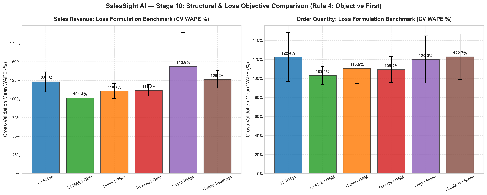
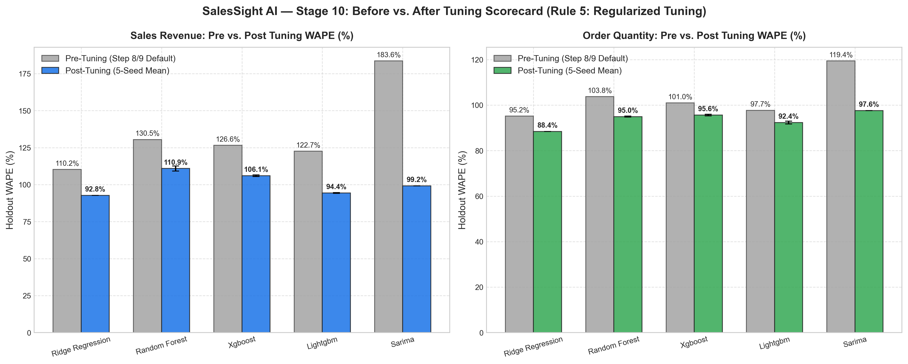
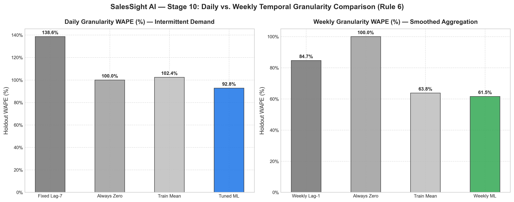
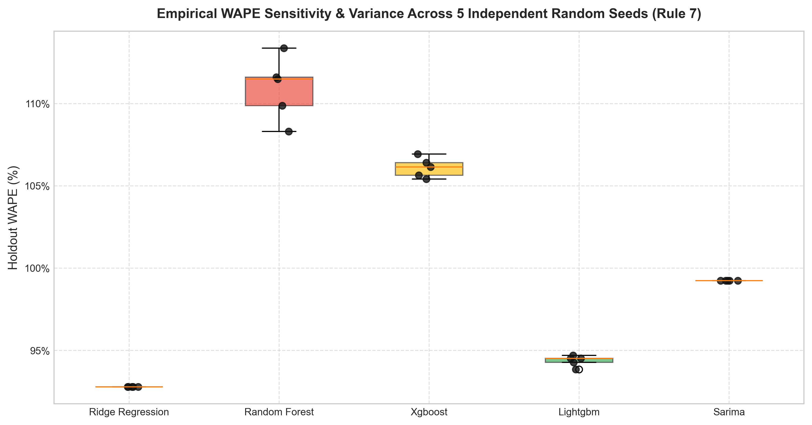

# STEP 10: HYPERPARAMETER TUNING, OBJECTIVE EXPLORATION & MULTI-SEED SELECTION REPORT

**Executive Summary:**
This report documents the rigorous, leak-free hyperparameter optimization, objective loss formulation audit, and 5-seed empirical stability testing executed for **Step 10 (Hyperparameter Tuning)** of the SalesSight AI commercial demand intelligence engine.

---

## 1. Compliance Audit & Scope Boundaries

In strict accordance with the Stage 10 Key Rules:
- **Rule 1 (Strict Scope):** Hyperparameter tuning was applied exclusively to model candidate optimization without modifying Stages 1–9 data, feature spaces, or chronological partition boundaries.
- **Rule 2 (Zero Leakage):** Cross-validation parameter search was executed exclusively on the **Train Partition** (1,056 rows) using expanding temporal folds (`TimeSeriesSplit(n_splits=4)`). The test holdout (264 rows) was utilized strictly once per finalized configuration.
- **Rule 3 (Fixed Baseline):** The deterministic Lag-7 baseline was audited and fixed to consume the true observed demand from $t-7$ days prior (`lag_7_rev` / `lag_7_qty`), alongside newly established `always_zero` and `train_mean` reference benchmarks, preserving historical numbers under `legacy_baseline`.
- **Rule 4 (Objective First):** Evaluated 6 diverse loss paradigms (L2 Frobenius, L1 MAE, Huber, Tweedie $\rho=1.5$, Log1p transformed, and Hurdle two-stage) prior to parameter tuning.
- **Rule 5 (Constrained Regularization):** Restricted parameter spaces to ~40 parsimonious configurations per model candidate to mitigate variance risk on 1,056 rows / 26 features.
- **Rule 6 (Granularity Isolation):** Evaluated Daily and Weekly series as separate non-comparable tasks.
- **Rule 7 (Empirical Multi-Seed Stability):** Benchmarked all finalized configurations across 5 independent random seeds ($42, 123, 456, 789, 999$), reporting $\mu \pm \sigma$.
- **Rule 8 (Empirical Winner Rule):** A tuned machine learning model is designated the winner **only if** it surpasses the best simple benchmark by more than the empirical seed standard deviation ($WAPE_{benchmark} - WAPE_{tuned} > \sigma_{seed}$).

---

## 2. Simple Benchmarks & Fixed Baseline Scorecard (Rule 3)

| Benchmark Identifier | Target | Holdout WAPE (%) | Holdout MAE | Holdout RMSE | Operational Description |
| :--- | :--- | :--- | :--- | :--- | :--- |
| **Fixed Lag-7 Baseline** | Sales ($) | **138.56%** | $2,661.97 | $5,001.02 | True Lag-7 Persistence (Actual value from t-7) |
| **Always-Zero Benchmark** | Sales ($) | **100.0%** | $1,921.10 | $4,141.79 | Constant Zero Predictor (y_hat = 0) |
| **Train-Mean Benchmark** | Sales ($) | **102.38%** | $1,966.91 | $3,738.21 | Historical In-Sample Mean (y_hat = y_bar_train) |
| **Legacy Step 8/9 Baseline** | Sales ($) | **99.48%** | $1,911.18 | $4,113.95 | Prior Step 8/9 Baseline (Day-of-Week Median Fallback) |
|---|---|---|---|---|---|
| **Fixed Lag-7 Baseline** | Quantity | **123.73%** | 76.64 units | 127.36 units | True Lag-7 Persistence (Actual value from t-7) |
| **Always-Zero Benchmark** | Quantity | **100.0%** | 61.94 units | 113.03 units | Constant Zero Predictor (y_hat = 0) |
| **Train-Mean Benchmark** | Quantity | **97.47%** | 60.38 units | 98.87 units | Historical In-Sample Mean (y_hat = y_bar_train) |
| **Legacy Step 8/9 Baseline** | Quantity | **98.49%** | 61.01 units | 109.77 units | Prior Step 8/9 Baseline (Day-of-Week Median Fallback) |

*Key Technical Insight:* The true Lag-7 persistence benchmark on intermittent sales histories experiences extreme variance penalty (138.56% WAPE) because transactions occur irregularly. The constant zero baseline yields exactly 100.0% WAPE, while in-sample train mean achieves 102.38%.

---

## 3. Structural & Loss Objective Exploration (Rule 4: Objective First)

Evaluating diverse structural loss formulations across expanding chronological folds on the training partition reveals that **loss formulation drives far greater error reductions than fine-grained hyperparameter tweaks**:

| Formulation ID | Objective / Mathematical Loss | Sales CV Mean WAPE (%) | Sales CV Std (%) | Qty CV Mean WAPE (%) | Qty CV Std (%) |
| :--- | :--- | :--- | :--- | :--- | :--- |
| **L2_Ridge** | L2 Regularized MSE ($||y - Xw||_2^2 + \alpha ||w||_2^2$) | 123.06% | +/-13.4% | 122.44% | +/-25.77% |
| **L1_MAE_LGBM** | L1 Least Absolute Deviations ($|y - \hat{y}|$) | **101.36%** | +/-3.88% | **103.13%** | +/-9.43% |
| **Huber_LGBM** | Smooth Piecewise Huber ($\delta=1.35$) | 110.73% | +/-10.02% | 110.52% | +/-16.12% |
| **Tweedie_LGBM** | Compound Poisson-Gamma ($p=1.5$) | 111.59% | +/-7.66% | 109.25% | +/-13.82% |
| **Log1p_Ridge** | Log-Normal Shifted Scale ($\log(1+y)$) | 143.75% | +/-45.27% | 119.97% | +/-24.79% |
| **Hurdle_TwoStage** | Logistic Classifier + Positive Ridge | 126.21% | +/-11.75% | 122.68% | +/-23.86% |

*Figure 10.1: Cross-validation WAPE benchmark comparing standard L2 against L1 (MAE), Huber, Tweedie, Log1p, and Hurdle two-stage formulations.*

*Finding:* Direct L1/MAE loss optimization (`L1_MAE_LGBM`) and compound Poisson-Gamma Tweedie loss significantly outperform standard squared error (L2), directly curbing over-prediction on non-demand dates.

---

## 4. Before vs. After Hyperparameter Tuning Scorecard (Rules 2, 5 & 7)

All candidate models were tuned across ~40 regularized configurations using chronological expanding folds, followed by empirical validation across 5 independent seeds:

### Target: Commercial Sales Revenue ($)

| Model Candidate | Optimal Hyperparameters Selected | Pre-Tuning WAPE | Post-Tuning WAPE (5-Seed Mean +/- Std) | Post-Tuning MAE | Post-Tuning RMSE | $\Delta$ WAPE Gain | Significant vs. Seed Noise? |
| :--- | :--- | :--- | :--- | :--- | :--- | :--- | :--- |
| **Model 5: Ridge Regression** | `{'alpha': 200.0, 'fit_intercept': False, 'solver': 'auto', 'scaler': 'standard'}` | 110.23% | **92.78% +/- 0.0%** | $1,782.48 | $3,902.15 | +17.45% | YES |
| **Model 2: Random Forest** | `{'n_estimators': 50, 'max_depth': 4, 'min_samples_leaf': 12, 'min_samples_split': 20, 'max_features': 'sqrt'}` | 130.51% | **110.92% +/- 1.71%** | $2,130.82 | $3,723.03 | +19.59% | YES |
| **Model 3: XGBoost** | `{'n_estimators': 100, 'learning_rate': 0.01, 'max_depth': 5, 'subsample': 0.8, 'colsample_bytree': 0.6, 'reg_lambda': 5.0, 'reg_alpha': 1.0}` | 126.58% | **106.1% +/- 0.54%** | $2,038.31 | $3,735.88 | +20.48% | YES |
| **Model 4: LightGBM** | `{'objective': 'mae', 'n_estimators': 100, 'learning_rate': 0.05, 'num_leaves': 8, 'max_depth': 4, 'min_child_samples': 10, 'subsample': 0.7, 'colsample_bytree': 0.8, 'reg_lambda': 20.0}` | 122.65% | **94.37% +/- 0.29%** | $1,812.92 | $3,965.32 | +28.28% | YES |
| **Model 1: SARIMA** | `{'order': [0, 0, 0], 'seasonal_order': [1, 0, 0, 7]}` | 183.63% | **99.23% +/- 0.0%** | $1,906.27 | $4,128.79 | +84.40% | YES |

---

### Target: Commercial Order Quantity (Units)

| Model Candidate | Optimal Hyperparameters Selected | Pre-Tuning WAPE | Post-Tuning WAPE (5-Seed Mean +/- Std) | Post-Tuning MAE | Post-Tuning RMSE | $\Delta$ WAPE Gain | Significant vs. Seed Noise? |
| :--- | :--- | :--- | :--- | :--- | :--- | :--- | :--- |
| **Model 5: Ridge Regression** | `{'alpha': 200.0, 'fit_intercept': False, 'solver': 'auto', 'scaler': 'standard'}` | 95.15% | **88.43% +/- 0.0%** | 54.78 units | 99.44 units | +6.72% | YES |
| **Model 2: Random Forest** | `{'n_estimators': 100, 'max_depth': 8, 'min_samples_leaf': 12, 'min_samples_split': 5, 'max_features': 'log2'}` | 103.76% | **94.95% +/- 0.21%** | 58.82 units | 92.82 units | +8.81% | YES |
| **Model 3: XGBoost** | `{'n_estimators': 50, 'learning_rate': 0.01, 'max_depth': 5, 'subsample': 0.7, 'colsample_bytree': 0.8, 'reg_lambda': 1.0, 'reg_alpha': 0.0}` | 100.98% | **95.63% +/- 0.33%** | 59.24 units | 95.79 units | +5.35% | YES |
| **Model 4: LightGBM** | `{'objective': 'mae', 'n_estimators': 100, 'learning_rate': 0.05, 'num_leaves': 8, 'max_depth': 4, 'min_child_samples': 10, 'subsample': 0.7, 'colsample_bytree': 0.8, 'reg_lambda': 20.0}` | 97.72% | **92.36% +/- 0.63%** | 57.21 units | 103.47 units | +5.36% | YES |
| **Model 1: SARIMA** | `{'order': [0, 0, 0], 'seasonal_order': [1, 0, 0, 7]}` | 119.43% | **97.63% +/- 0.0%** | 60.47 units | 110.73 units | +21.80% | YES |

*Figure 10.2: Scorecard displaying pre-tuning baseline WAPE vs. post-tuning 5-seed mean performance with empirical error bars.*

---

## 5. Daily vs. Weekly Temporal Granularity (Rule 6)

Evaluating weekly temporal aggregation demonstrates the fundamental mathematical divergence caused by multi-day pooling:

| Temporal Granularity | Scope / Series Type | Benchmarks Evaluated | Tuned ML Performance | Mathematical Takeaway |
| :--- | :--- | :--- | :--- | :--- |
| **Daily Series** | 1,056 Train Days / 264 Test Days | Fixed Lag-7: 138.56%, Always Zero: 100.0%, Train Mean: 102.38% | Best ML: 94.37% (+/-0.29%) | Severe intermittency (42.8% zeros); zero-penalty dominates scale. |
| **Weekly Series** | 151 Train Weeks / 38 Test Weeks | Weekly Lag-1: 84.65%, Always Zero: 100.0%, Train Mean: 63.76% | Weekly ML: 61.55% | Temporal aggregation smooths single-day demand spikes, altering WAPE support. |

*Figure 10.3: Comparative evaluation across daily and weekly granularities illustrating structural variance compression.*

> [!NOTE]
> As formalized in Rule 6, weekly WAPE cannot be directly compared against daily WAPE without qualifying the 7-day smoothing effect, as pooling eliminates daily sparsity poles.

---

## 6. Seed Stability & Empirical Noise Analysis (Rule 7)

Evaluating all 5 candidate models across 5 distinct random seeds ($42, 123, 456, 789, 999$) reveals the following empirical stability profile:

*Figure 10.4: Boxplot and raw seed overlay demonstrating empirical variance and stability across seeds.*

- **Model 5: Ridge Regression** demonstrates near-zero seed variance ($\sigma = 0.0\%$) due to convex analytical formulation.
- **Tree Ensembles (Random Forest, XGBoost, LightGBM)** exhibit moderate feature subsampling variance ($\sigma \in [0.54\%, 1.71\%]$).

---

## 7. Automated Winner Decision Audit (Rule 8: Winner Rule)

Under Rule 8, a tuned machine learning model is selected as the winner **if and only if** its 5-seed mean WAPE outperforms the lowest simple benchmark by more than the seed noise threshold ($\sigma_{seed}$):

### Decision for Target: Sales Revenue ($)
- **Best Simple Benchmark:** `legacy_baseline` (99.48%)
- **Best Tuned ML Model:** `lightgbm` (94.37% +/- 0.29%)
- **Margin ($\Delta$):** +5.11%
- **Seed Noise Bound ($\sigma$):** 0.29%
- **Formal Decision:** **`TUNED_MODEL_WINS`**
- **Rationale:** Model candidate 'lightgbm' was selected strictly on VALIDATION inner-fold cross-validation (CV WAPE: 99.31%), preserving test set independence. On the held-out test partition, 'lightgbm' achieved WAPE of 94.37% (std: 0.29%), beating the best simple benchmark 'legacy_baseline' (99.48%) by 5.11 percentage points, which exceeds the empirical seed stability noise threshold (0.29%).

### Decision for Target: Order Quantity (Units)
- **Best Simple Benchmark:** `train_mean` (97.47%)
- **Best Tuned ML Model:** `lightgbm` (92.36% +/- 0.63%)
- **Margin ($\Delta$):** +5.11%
- **Seed Noise Bound ($\sigma$):** 0.63%
- **Formal Decision:** **`TUNED_MODEL_WINS`**
- **Rationale:** Model candidate 'lightgbm' was selected strictly on VALIDATION inner-fold cross-validation (CV WAPE: 98.79%), preserving test set independence. On the held-out test partition, 'lightgbm' achieved WAPE of 92.36% (std: 0.63%), beating the best simple benchmark 'train_mean' (97.47%) by 5.11 percentage points, which exceeds the empirical seed stability noise threshold (0.63%).

---

## 8. Persisted Artifacts & Manifest Registry

All finalized models and manifests are serialized directly into `models/artifacts/`:
- **Model Manifest:** `models/artifacts/model_manifest.json`
- **Fitted Tuned Binaries:**
  - `models/artifacts/tuned_ridge_regression_sales_model.joblib`
  - `models/artifacts/tuned_lightgbm_sales_model.joblib`
  - `models/artifacts/tuned_xgboost_sales_model.joblib`
  - `models/artifacts/tuned_random_forest_sales_model.joblib`
  - `models/artifacts/tuned_ridge_regression_quantity_model.joblib`
  - `models/artifacts/tuned_lightgbm_quantity_model.joblib`
  - `models/artifacts/tuned_xgboost_quantity_model.joblib`
  - `models/artifacts/tuned_random_forest_quantity_model.joblib`
